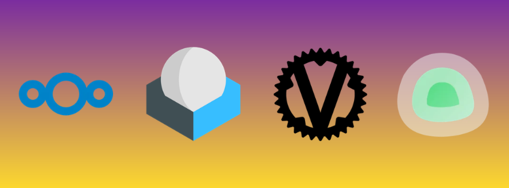

# kefoCloud


A Debian installer that turns one machine into a set of containerised apps behind a single HTTPS edge: each app ships here as a compose unit under `modules/`, the installer provisions the ones you name, and a `Makefile` keeps operating them afterwards. Certificates come from Let's Encrypt (DNS-01 through Cloudflare), DNS records are created for you, credentials are minted at install time, and the run only reports success after a live smoke test has checked every door.

## Install

```bash
git clone https://github.com/kefohaine/kefoCloud.git
cd kefoCloud && sudo bash scripts/install/wizard.sh
```

Root only, and every input is collected **before** anything changes — the device's public SSH key, a Tailscale auth key, a Cloudflare API token, the domain, and the app list (space-separated, or `all`) — with an optional GitHub collaborator step that mints a push key and flips `origin` to SSH. Each answer is written to `state` as it is given, so an aborted run resumes instead of starting over. After that it runs unattended through an 18-row checklist — packages, SSH hardening, firewall, Tailscale, Docker, Goose, repository setup, host services, DNS records, repo hygiene, stack config, containers, certificates, mail, Nextcloud, Vaultwarden, monitoring, smoke — where a failing row pauses on itself and hands the error over (`[FAIL]` + hint), the later rows wait, and nothing is marked done that isn't.

```bash
sudo bash scripts/install/uninstall.sh
```

The reverse, module by module: each removal is an explicit yes, data and the tailnet membership go last, and nothing is deleted that the script did not install.

## Apps



Every app is declared once in `config/modules.conf` (name → directory → host label → containers) and everything else follows from that one line: `make fetch`, `make smoke`, the installer's app list, the vhosts, and the per-app recipes.

| app | module | containers | door |
|---|---|---|---|
| Nextcloud | `cloud` | `nextcloud` `postgresql` `redis` `talk-hpb` `talk-relay` `notify-push` | `nextcloud.` + `cloud.` |
| ownCloud Infinite Scale | `ocis` | `ocis` | `cloud.` |
| Snikket (XMPP) | `xmpp` | `snikket-server` `snikket-proxy` `snikket-portal` `snikket-certs` | `chat.` |
| Vaultwarden | `vault` | `vaultwarden` | `vault.` |
| Mailu + Roundcube | `mail` | `mailu-front` `mailu-imap` `mailu-smtp` `mailu-antispam` `mailu-admin` `mailu-redis` `roundcube` | `mail.` + `mailu.` |
| Uptime Kuma | `monitor` | `uptimekuma` | `kuma.` |
| Homarr | `home` | `homarr` | `home.` |
| WriteFreely | `blog` | `writefreely` | `blog.` |
| Immich | `photos` | `immich-server` `immich-db` `immich-redis` | `photos.` |

The edge is a Caddy build with `caddy-dns/cloudflare` in host-network mode, one `modules/caddy/vhosts/<host>.caddy` per door (`www`, `cloud`, `nextcloud`, `talk`, `photos`, `mail`, `mailu`, `kuma`, `home`, `blog`, `chat`, `vault`, `ttyd`). Every image is pinned to a version tag; `caddy` and `writefreely` are built locally, the rest are pulled as declared in their compose files. Nothing is installed by default — a module that is off has no container, no data and no route.

Host side: `dnsmasq` (split DNS so tailnet devices resolve `$DOMAIN` to this box), `ttyd` behind a single `tmux` session (`tmux-main.service`), `fail2ban`, hardened `sshd`, `ufw`, `cron`, and the Goose agent plus its `goose.service`. `kefo-stack.service` brings every deployed compose unit back up on boot.

## Operating it

The `Makefile` is the interface — `make help` lists the short set, `make help-more` the rest.

| group | what it does | examples |
|---|---|---|
| containers | recreate / restart / stop / log one container, or `-all` | `make dok-recreate-caddy`, `make dok-logs-all` |
| host services | restart / log one unit, or `-all` | `make systemd-restart-dnsmasq`, `make systemd-log-goose` |
| Nextcloud | everything through `occ` in the app container | `make nc-status`, `make nc-user-add`, `make nc-app-enable`, `make nc-core-update VERSION=x.y.z` |
| mail | Mailu accounts, aliases, quotas, DKIM, TLS, queue, registry export/import | `make mail-gen`, `make mail-dkim`, `make mail-config-export` |
| other apps | accounts without a CLI, driven by scripts under `scripts/modules/` | `make kuma-passwd`, `make vaultwarden-add-user`, `make snikket-invite`, `make immich-grant-admin`, `make writefreely-add-user` |
| maintenance | pull + recreate every deployed unit with the edge last, smoke test, read-only fleet report, DNS sync, config push | `make update`, `make smoke`, `make fetch`, `make fetch-more`, `make deploy`, `make dns-sync` |
| backups | taildrop bundles (PostgreSQL dump + datadirs) or raw datadirectory trees, and restore | `make backup TAILDROP=<device>`, `make import-backups` |
| git | issues, branches, one-change commits, pull requests | `make git-issue`, `make git-start`, `make git-com`, `make git-pr` |
| Goose | the recipes in `recipes/` run through the agent | `make goose-audit`, `make goose-troubleshoot`, `make goose-deploy-plan` |

`scripts/ops/optimize.sh` is the host tuner (sysctl, docker daemon config, dnsmasq cache, apt/docker cleanup, extra distro units off), with `--dry-run` and `--verify`. `scripts/ops/nc-datadir-nfs.sh` moves the Nextcloud datadirectory onto another tailnet machine, and `scripts/stack/stack-up.sh` is the only bring-up path (`--update`, `--check`, `--validate`).

## Layout

```
modules/     one directory per app: compose file, vhosts live under modules/caddy/
config/      tracked copies of host configs + catalogues (modules.conf, instance.defaults)
scripts/     install/ (wizard + uninstall), ops/, stack/, render/, modules/, lib/, hooks/, info/
recipes/     Goose agent tasks (audit, review, troubleshoot, validate, plan)
data/        instance state written at install time — never committed
```

Rendered files land in `rendered/`, instance data in `data/`; both are produced by `make render` / `make deploy` from `config/` and `data/instance.conf`, so nothing instance-specific is committed.

## What you need

- Debian on the machine, root access, a public IPv4, and ports 80/443 reachable (mail and XMPP publish their own: 25, 465, 587, 993 for mail; 5222, 5269 and TURN 3478/3479 for XMPP).
- A domain in a Cloudflare zone, with an API token that can edit DNS for it.
- A Tailscale account and auth key — the tailnet is how the ssh-only box and the tailnet-only doors (`ttyd`, `vault`, `nextcloud`, `mailu`) are reached.
- Disk and RAM for the apps you enable: the pinned images are the biggest fixed cost, and the data directories grow with what you put in them.

## License

MIT — see `LICENSE`.
