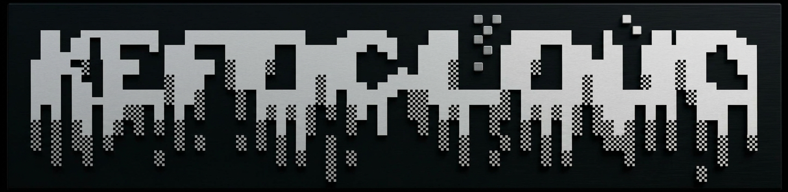
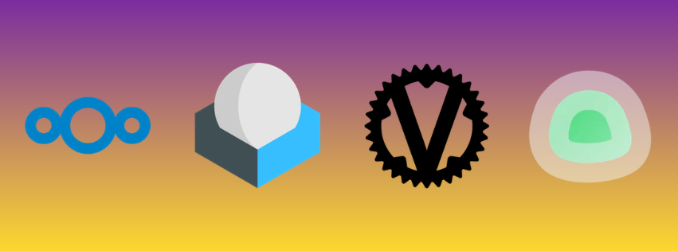

# kefoCloud



A self-hosted apps installer for Debian. One command turns a fresh box into your own private kit of apps — files, passwords, mail, chat, photos, monitoring, a dashboard — installed behind a single HTTPS edge, under your own domain, on hardware that is yours alone.
Fork it, run the installer, say which apps you want: the same set is yours, with no server but yours.

## Install

```bash
git clone https://github.com/kefohaine/kefoCloud.git
cd kefoCloud && bash scripts/install/wizard.sh
```

Prompts once then runs unattended — errors are listed with a hint each and re-checked until resolved, and success is only granted when the smoke check passes

`scripts/install/uninstall.sh` reverses it in the same style — no prompt has a default (only `yes`/`no` are accepted), operator data and the tailscale-only SSH path are never touched without an explicit confirm, and the tailnet membership goes last. Removal is the operator's call, never the installer's.

### Apps



Every app is one self-contained unit — its own compose file, its own vhost, its own data directory — so the installer provisions exactly the ones you pick and nothing else. The compatible set: Nextcloud (with PostgreSQL, Redis and Talk HPB/TURN), oCIS, Snikket for XMPP chat, Vaultwarden, the Mailu + Roundcube mail platform, Uptime Kuma, Homarr, WriteFreely and Immich photos, all behind a Caddy edge that holds one certificate per door. Public doors run through Cloudflare; the admin doors (Nextcloud, Vaultwarden, the Mailu platform, the shell) answer only inside your tailnet. Tailscale, ttyd, dnsmasq and the goose agent run as host services beside the containers, and per-app `make` commands for accounts and maintenance ship with them.

| app | what you get | door |
|---|---|---|
| **Cloud** | Nextcloud — files, calendar, contacts, Talk | `nextcloud.` inside the tailnet; the public `cloud.` door is proxied (app choices in `config/cloud/apps.conf`, untracked and empty by default; `spreed`/`app_api` are enforced in code, never asked) |
| **oCIS** | ownCloud Infinite Scale, the second cloud | `cloud.` — its own web UI, proxied |
| **Chat** | Snikket — XMPP server, proxy and TURN | `chat.` (plus `groups.chat` / `share.chat`), DNS-only so the proxy cannot break XMPP |
| **Vault** | Vaultwarden — any Bitwarden client, server included | `vault.` — tailnet-only |
| **Mail** | Mailu + Roundcube — SMTP/IMAPS, DKIM/SPF/DMARC on your own domain | public webmail, `mailu.` platform door tailnet-only |
| **Monitor** | Uptime Kuma — watches public *and* tailnet-only doors | `kuma.`, proxied |
| **Home** | Homarr — the dashboard (the welcome page's Home link) | `home.`, proxied |
| **Blog** | WriteFreely — SQLite, pinned upstream release | `blog.`, proxied |
| **Photos** | Immich — its own PostgreSQL + Redis | `photos.`, DNS-only so uploads skip the proxy |

#### Presets

The installer asks once, on a single prompt that prints the app keys: answer `all` for every compatible app, or name the subset you want (space-separated, e.g. `cloud vault monitor`). The answer is recorded in `wizard.state`, so a later run reuses it instead of asking again.

### Tips

- `bash scripts/ops/optimize.sh` — automated performance optimization after install; useful for resource management
- `make nc-datadir-nfs` — make an external machine the PERMANENT live Nextcloud datadir host over the tailnet; the database stays on this machine; useful for bulky external storage
- `make backup TAILDROP=<device>` ships every installed app to a Tailscale device as verified bundles (default) or raw datadirectories (`BACKUP_MODE=raw`); restore with `make import-backups`; useful for safety & migration

## Documentation

- `docs/SKELETON.md` — the skeleton: placeholder tokens, values and rendering
- `docs/GUIDE.md` — the operator manual: layout, recipes, per-service facts, gotchas
- `docs/AGENTS.md` — agent operating rules
- `docs/DEBUG.md` — deep-scan diagnostics runbook
- `docs/MIGRATE.md` — moving the install to a new machine

## Risks & Considerations
- System Requirements: minimum RAM is 4GB; minimum storage is 15GB; kefohaine recommends double the minimum for both specifications to avoid bottleneck.
- Single Point of Failure: Running your cloud, your passwords, your email and your monitoring on one operating system means that if the host crashes, goes offline, or gets compromised, your entire digital footprint goes dark simultaneously. If anything breaks when you install as intended, report it here as an issue; Please don't open an issue if it was caused from manual tweaks on your end.
- The Mail Server Headache: Operating a self-hosted mail server is notoriously difficult. Even if the project configures your DKIM and SPF records perfectly, large providers like Gmail, Yahoo, and Outlook frequently block or flag IP addresses originating from residential connections or cheap cloud host networks.
