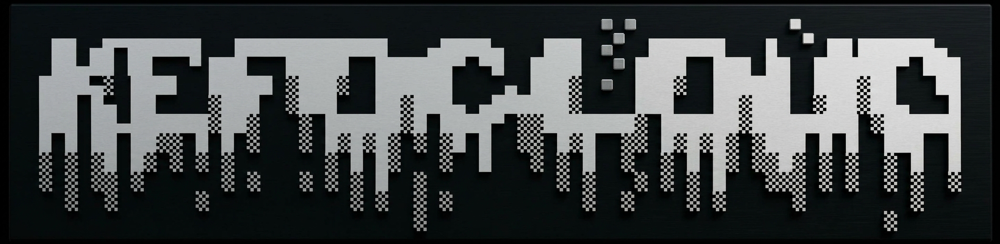

# kefoCloud



**One Debian box, your own apps, no cloud in the middle.** kefoCloud is an installer plus a Makefile that turn a fresh machine into a private app server: Nextcloud, mail, passwords, chat, photos, a blog and a dashboard — each as its own Docker Compose unit, all behind one HTTPS edge.

```bash
git clone https://github.com/kefohaine/kefoCloud.git
cd kefoCloud && sudo bash scripts/install/wizard.sh
```

The wizard asks for five things up front (SSH key, Tailscale key, Cloudflare token, domain, which apps), then works unattended: DNS records, certificates, databases, mailboxes and admin accounts, ending with a live check of every door. Re-run it any time — it repairs instead of rebuilding.

## Why this one

- **Private by default.** Your photos, files, mail and passwords live on hardware you own. Admin doors never enter public DNS at all: they answer only to devices on your Tailscale network.
- **Secure where it counts.** Key-only SSH on the tailnet, deny-by-default firewall, per-vhost Let's Encrypt certificates, rate-limited mail with SPF/DKIM/DMARC, fail2ban, secrets generated at install and never committed, every image pinned to a version tag.
- **Fast and frugal.** Every container carries a hard memory cap (the edge is capped at 128 MB), so one runaway process cannot take the box down; a single host tuner (`scripts/ops/optimize.sh`) trims sysctl, Docker and DNS overhead.
- **Simple to run.** One bootstrap, one `make help`, no YAML archaeology: `make update` pulls and recreates what is actually deployed, `make smoke` proves every door still serves its app, `make fetch` prints the whole machine state in one screen.
- **Compatible, not clever.** Stock upstream images (Nextcloud, Mailu, Vaultwarden, Immich, Snikket, Uptime Kuma, Homarr, WriteFreely, oCIS), standard Docker Compose files you can read, and plain Debian underneath — migrate a machine, keep your data.
- **Reversible.** `scripts/install/uninstall.sh` takes the same installation apart module by module, and `make backup` ships everything to a tailnet device before you touch anything.

## What you can install

`cloud` (Nextcloud + Talk) · `ocis` · `xmpp` (Snikket) · `vault` (Vaultwarden) · `mail` (Mailu + Roundcube) · `monitor` (Uptime Kuma) · `home` (Homarr) · `blog` (WriteFreely) · `photos` (Immich) — pick any subset, or `all`.

## Read next

- **[docs/MANUAL.md](docs/MANUAL.md)** — everything: what the machine is and why, install/repair/uninstall, migration, backup, the service reference, the diagnostic runbook and the operational gotchas.
- **[docs/AGENTS.md](docs/AGENTS.md)** — the rules an agent follows in this repo.

## License

MIT — see `LICENSE`.
